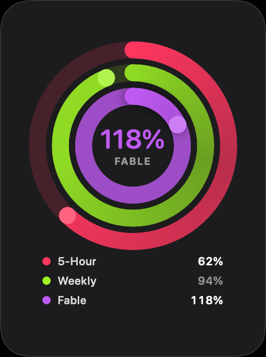
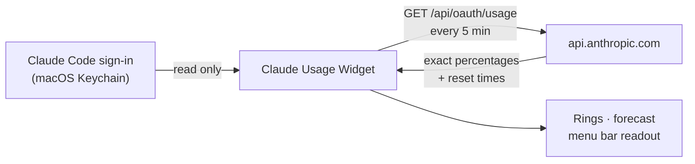

<p align="center">
  
</p>

<h1 align="center">Claude Usage Widget</h1>

<p align="center">
  <strong>Your Claude Code limits, as Apple-Watch-style activity rings — always on top, one glance away.</strong>
</p>

<p align="center">
  <a href="https://github.com/melucasleite/claude-usage-widget/releases/latest"></a>
  
  
  
  <a href="LICENSE"></a>
</p>

<p align="center">
  
  <br>
  <sub>Demo values — rendered offscreen with <code>--render-preview</code>, so nobody's real usage is in this picture.</sub>
</p>

---

Claude Code's `/usage` tells you exactly how close you are to your limits — but
only when you stop and ask. **Claude Usage Widget** keeps the same numbers
floating on your desktop as three concentric rings, so you see a limit coming
long before it arrives. It reads the sign-in Claude Code already has, so there
is nothing to paste, and every percentage it shows came straight from
Anthropic's own usage endpoint.

## ✨ Highlights

- **Three rings, three limits** — the rolling 5-hour session, the weekly
  all-models limit, and the weekly Fable limit. Going over 100% draws a second
  lap, just like closing your Move ring twice.
- **Forecast view** — one click flips the widget to a chart of a limit's
  recent trajectory and answers the only question that matters: _at this pace,
  do you hit 100% before the reset?_
- **Zero setup** — reuses Claude Code's existing sign-in. No API key, no token
  to copy around.
- **Honest numbers only** — no local estimation, ever. If the data is not
  there, the ring says "—" instead of guessing.
- **Polite to the API** — polls every five minutes, caches the last reading so
  relaunching is free, persists rate-limit backoff to disk, and shows a live
  countdown instead of hammering a `429`.
- **Native and lightweight** — a borderless SwiftUI/AppKit panel with no Dock
  icon. Drag it anywhere, resize from any edge, keep it on every Space, or
  tuck it away behind a menu bar readout.
- **Signed and notarized** — download the `.dmg`, drag to Applications, done.

| Ring       | Colour    | What it measures                |
| ---------- | --------- | ------------------------------- |
| **5-Hour** | 🔴 red    | Rolling 5-hour session window   |
| **Weekly** | 🟢 green  | 7-day rolling limit, all models |
| **Fable**  | 🟣 violet | Weekly Fable-model limit        |

Any ring can be switched off in **Settings ▸ Rings**.

## 📦 Install

1. **[Download the latest `.dmg`](https://github.com/melucasleite/claude-usage-widget/releases/latest)**,
   open it, and drag **Claude Usage Widget** to Applications.
2. Make sure Claude Code is signed in on this Mac — if you have not already:
   ```bash
   claude
   ```
3. Launch the app. If it cannot find a sign-in, a short setup guide opens with a
   **Test connection** button that makes one real request to prove it works.

**Requirements:** macOS 14 or later, Claude Code signed in with a Claude
subscription.

> [!TIP]
> To start it with your Mac, add it under **System Settings ▸ General ▸ Login
> Items**.

## 🖱️ Using it

| Do this                    | And                                                                                                                                    |
| -------------------------- | -------------------------------------------------------------------------------------------------------------------------------------- |
| **Hover a ring**           | The centre readout previews that ring; the tooltip adds the reset countdown.                                                           |
| **Click a ring**           | Pins it to the centre (persists across relaunches). Click again to unpin — unpinned, the centre follows whichever ring is most urgent. |
| **Hover the widget**       | Reveals controls: quit (top-left); forecast toggle, refresh and settings (top-right).                                                  |
| **Drag / pull an edge**    | Moves or resizes the widget, with native macOS resize cursors. Position and size are remembered.                                       |
| **Right-click / menu bar** | Full menu: _Centre Shows_, _Always on Top_, _Hide Widget_, _Refresh Now_ (⌘R), _Settings…_ (⌘,), _Quit_.                               |

Closing the widget quits the app — the widget _is_ the app. To keep it running
but out of sight, use **Hide Widget** instead.

### 📈 Forecast view

Toggle it from the hover controls. It charts one limit — what the API reported
is a solid line, the projection is dashed, and the reset sits on its own dashed
vertical line — then gives a verdict such as _"On pace to hit 100% in 3h 10m — 40m
before the reset"_ or _"Reset in 2h 5m beats your pace"_. It needs about an hour
of readings before it will call a trend; the pill switcher at the bottom picks
which limit to forecast.

## ⚙️ How it works



- **One data source:** `GET https://api.anthropic.com/api/oauth/usage` — the
  same endpoint `/usage` inside Claude Code talks to. It returns exact
  percentages and reset times; the widget draws them and nothing else.
- **One credential:** the OAuth sign-in Claude Code stores in your Keychain
  (or `~/.claude/.credentials.json`). It is only ever read.
- **Gentle polling:** every 5 minutes by default (adjustable from 1 to 15 in
  **Settings ▸ Connection**), with a hard 20-second floor between requests no
  matter what triggers them.
- **Local state** — settings, the cached last reading, rate-limit backoff and
  up to 8 days of usage history for the forecast — lives in
  `~/Library/Application Support/ClaudeUsageWidget/`. No credential is ever
  written there.

## 🔒 Privacy & security

- The credential is **only ever read** — never written, copied or cached: not
  to `config.json`, not to logs, not to disk.
- The only network request the app makes is the usage call to
  `api.anthropic.com`.
- It reads through `/usr/bin/security` first. Claude Code creates its Keychain
  item with that same tool, which puts it on the item's access list, so the
  read is silent rather than a Keychain prompt.
- `OAuthCredentials` prints itself as `<redacted>`, and a unit test asserts it —
  removing the redaction turns the build red.
- `--check` diagnostics never print a token value, only metadata such as
  expiry.
- No credential of any kind is in this repository, and `.gitignore` carries
  backstop patterns to keep it that way.

## 🩺 Troubleshooting & FAQ

<details>
<summary><b>The widget says "Start a Claude Code session to get your stats".</b></summary>

Claude Code's stored sign-in expires every few hours, and only actually using
Claude Code renews it. Rather than retrying against a wall all night (an
expired token refuses every request identically), the widget **stops
requesting entirely** and watches the Keychain instead. Start a Claude Code
session and it picks up the fresh credential on its own.

</details>

<details>
<summary><b>Why can't I just use <code>claude setup-token</code>?</b></summary>

Because the endpoint refuses it, and says so precisely:

```
HTTP 403
permission_error: OAuth token does not meet scope requirement user:profile
```

Claude Code's interactive login requests `user:profile user:inference
user:sessions:claude`; `setup-token` grants inference only. No amount of
regenerating it will add the missing scope. The desktop app is no help either:
it keeps a claude.ai web session in an Electron cookie jar, not an OAuth bearer
token.

</details>

<details>
<summary><b>The rings show a countdown instead of numbers.</b></summary>

The usage endpoint is rate limited more tightly than it looks. When it answers
`429`, the widget shows how long the wait is and resumes by itself the moment
it ends — clicking Refresh during a long server-directed wait would only
deepen it. The backoff is persisted to disk, so quitting and relaunching does
not reset it.

</details>

<details>
<summary><b>Ask the app what is wrong: <code>--check</code></b></summary>

```bash
/Applications/ClaudeUsageWidget.app/Contents/MacOS/ClaudeUsageWidget --check
```

Reports which Keychain items it found, whether the credential parsed and when
it expires, whether the endpoint answered, and which rings resolved. It honours
any active rate-limit wait; pass `--force` to query anyway (which will probably
deepen the wait). If you built from source, the binary is at
`./dist/ClaudeUsageWidget.app/Contents/MacOS/ClaudeUsageWidget`.

</details>

<details>
<summary><b>Why isn't it on the Mac App Store?</b></summary>

The Mac App Store requires sandboxing, and a sandboxed app cannot read Claude
Code's Keychain item or invoke `/usr/bin/security` — which is every one of this
app's data paths. So it ships the way most Mac utilities do: **Developer ID +
notarization**.

</details>

## 🛠️ Build from source

Not needed to use it — [the release](https://github.com/melucasleite/claude-usage-widget/releases/latest)
is the easy path. This is for hacking on it.

```bash
git clone https://github.com/melucasleite/claude-usage-widget.git
cd claude-usage-widget
./Scripts/build-app.sh --run
```

That builds `dist/ClaudeUsageWidget.app` with plain SwiftPM — no `.xcodeproj`
required — and launches it.

| Command                           | What it does                                                 |
| --------------------------------- | ------------------------------------------------------------ |
| `swift build` / `swift test`      | Day-to-day build and tests                                   |
| `./Scripts/build-app.sh [--run]`  | Build the `.app` bundle into `dist/` (`--debug` for debug)   |
| `./Scripts/make-icon.sh <png>`    | Regenerate `Resources/AppIcon.icns` from a square PNG        |
| `./Scripts/make-dmg.sh <version>` | Build a drag-to-Applications disk image                      |
| `./Scripts/release.sh <version>`  | Sign, notarize, staple, package and publish a GitHub Release |

> [!NOTE]
> SwiftUI's `@State` and friends are macros, expanded by a plugin that ships
> inside Xcode and **not** with the standalone Command Line Tools. The build
> script finds any installed Xcode automatically and borrows it via
> `DEVELOPER_DIR` — no `xcode-select`, no `sudo`. Override it if you like:
>
> ```bash
> DEVELOPER_DIR=/Applications/Xcode.app/Contents/Developer ./Scripts/build-app.sh
> ```

`build-app.sh` signs with a real certificate when it finds one (set
`CODESIGN_IDENTITY` to choose), because Keychain grants bind to code identity
and an ad-hoc signature is invalidated by every rebuild.

### Tests

```bash
swift test
```

Covers the parts that fail quietly: decoding a payload whose keys are not
guaranteed, resolving Fable by display name and by codename fallback, treating
a null model window as 0%, credential parsing and redaction, ring hit-testing,
trend and projection maths, and the rule that cosmetic settings never trigger a
network call.

<details>
<summary><b>🔬 Under the hood: the unofficial usage endpoint</b></summary>

<br>

The endpoint is **unofficial and undocumented**. A trimmed, illustrative
response:

```json
{
  "five_hour": { "utilization": 30.0, "resets_at": "..." },
  "seven_day": { "utilization": 47.0, "resets_at": "..." },
  "seven_day_omelette": null,
  "limits": [
    {
      "kind": "weekly_scoped",
      "percent": 3,
      "scope": { "model": { "display_name": "Fable" } }
    }
  ]
}
```

Things worth knowing if you build something similar:

- **The `limits` array is the authoritative source.** Each row has a `kind`
  (`session`, `weekly_all`, `weekly_scoped`) and, for per-model rows, the
  model's display name. The widget reads all three rings from it first.
- **Top-level per-model keys are internal codenames, not model names.** There
  is no `seven_day_fable`; a live response carries keys like
  `seven_day_omelette` alongside decoys such as `cinder_cove` and
  `nimbus_quill`. An earlier version guessed the mapping and the Fable ring sat
  at 0% while real usage climbed — which is why `limits` now wins. The codename
  lookup survives only as a fallback for responses without `limits`, and can be
  pinned with `fableWindowKey` in `config.json`.
- **`null` means 0%, not "unavailable".** A per-model key that is present but
  null means the window applies to your account with no usage yet — which is
  how `/usage` renders it.
- **`User-Agent: claude-code/<version>` is not optional in practice.** Without
  it you land in an aggressively rate-limited bucket and get persistent `429`s.
- **There is deliberately no local estimation.** An earlier version derived
  percentages from transcript token counts when the API was unreachable, which
  meant inventing a denominator — and it once confidently displayed **3704%**.
  The forecast view is the one piece of local arithmetic, it uses only readings
  the API returned, and it is always drawn dashed and labelled as a projection.
- **Backoff is persisted.** Keeping it in memory quietly defeats it: a handful
  of relaunches can turn a short `Retry-After` into an hour-long one. The last
  successful response is cached too, so relaunching costs no request.

</details>

<details>
<summary><b>🧭 Architecture</b></summary>

<br>

```
Sources/ClaudeUsageWidget/
├── main.swift                    entry point; --check and --render-preview
├── App/
│   ├── AppDelegate.swift         wiring, windows, main menu
│   ├── WidgetPanel.swift         borderless, non-activating, resizable NSPanel
│   ├── StatusItemController.swift  menu bar readout and menu
│   ├── Diagnostics.swift         --check
│   └── PreviewRenderer.swift     --render-preview
├── Core/
│   ├── Models.swift              RingMetric, RingDatum, UsageSnapshot
│   ├── Config.swift              settings, persisted as JSON
│   └── UsageHistory.swift        recorded readings and trend projection
├── Data/
│   ├── CredentialStore.swift     reads Claude Code's credential; redaction
│   ├── OAuthUsageProvider.swift  the endpoint and its tolerant decoder
│   └── UsageCoordinator.swift    refresh loop, cache, persisted backoff
└── UI/
    ├── ActivityRingsView.swift   adaptive geometry, overflow laps
    ├── WidgetView.swift          rings, forecast, or the sign-in prompt
    ├── ForecastView.swift        trajectory chart and verdict
    ├── WaitingView.swift         rate-limit countdown
    ├── OnboardingView.swift      sign in → test connection
    └── SettingsView.swift        Appearance · Rings · Connection
```

</details>

<details>
<summary><b>🚀 Distribution & releasing</b></summary>

<br>

#### Generating the Xcode project

Everyday work needs no Xcode project. But a Swift _package_ opened in Xcode has
no Signing & Capabilities tab and no `Product ▸ Archive`, so for the Organizer
flow you need a real App target, generated from `project.yml` by XcodeGen:

```bash
brew install xcodegen && DEVELOPMENT_TEAM=YOURTEAMID xcodegen generate && open ClaudeUsageWidget.xcodeproj
```

Pass `DEVELOPMENT_TEAM` rather than setting the team in Xcode's UI — the UI
writes it into the generated project, which the next `xcodegen generate`
overwrites. `project.yml` is the source of truth; the `.xcodeproj` is
git-ignored. Hardened runtime is enabled there (notarization rejects builds
without it) and the sandbox is explicitly off, for the reasons in the FAQ.

#### Signing certificates: the iOS gotcha

| Certificate                  | What it is for                     | Works outside the store?       |
| ---------------------------- | ---------------------------------- | ------------------------------ |
| **Apple Development**        | local builds, registered devices   | no — blocked on other Macs     |
| **Apple Distribution**       | App Store / TestFlight submissions | no — not a Gatekeeper identity |
| **Developer ID Application** | direct distribution                | **yes**                        |

Coming from iOS, _Apple Distribution_ is the trap: it reads as the "release"
certificate, but it is not accepted for notarized direct distribution. Create a
**Developer ID Application** certificate in Xcode ▸ Settings ▸ Accounts ▸
Manage Certificates ▸ **+** (paid Apple Developer Program, Account Holder
only), then verify:

```bash
security find-identity -v -p codesigning | grep "Developer ID Application"
```

You can confirm the chain before ever archiving:

```bash
CODESIGN_IDENTITY="Developer ID Application: Your Name (TEAMID)" ./Scripts/build-app.sh && spctl -a -vvv -t install dist/ClaudeUsageWidget.app
```

A correctly signed but not-yet-notarized app reports `rejected` with
`source=Unnotarized Developer ID` — the expected result at that stage.

#### Cutting a release

Store notarization credentials once (needs an app-specific password from
appleid.apple.com):

```bash
xcrun notarytool store-credentials "ClaudeUsageWidget" --apple-id you@example.com --team-id YOURTEAMID
```

Then:

```bash
./Scripts/release.sh 1.2.0
```

It signs with the Developer ID certificate, notarizes, staples, builds the
drag-to-Applications `.dmg` (notarized and stapled separately from the app
inside it, since Gatekeeper assesses the container you double-click), writes a
SHA-256 checksum, and creates the GitHub Release. It fails early on a missing
hardened runtime or secure timestamp, and re-runs the Gatekeeper check on a
copy tagged with a download quarantine flag — because an app can pass on the
machine that built it and still be refused as a download. Useful flags:
`--no-publish`, `--draft`, and `--app PATH` to reuse an existing build.

#### Release notes

Notes are written as the work happens, one line per user-visible change, in
`ReleaseNotes/Unreleased.md` (rules in `ReleaseNotes/CLAUDE.md`, so an agent
working in the repo keeps it current too). `release.sh` archives them to
`ReleaseNotes/v<version>.md`, publishes them in the release body, resets the
scratch file — and **refuses to release** when it is empty.

#### App icon and screenshots

```bash
./Scripts/make-icon.sh ~/Downloads/your-icon.png
```

Generates the full ten-size `Resources/AppIcon.icns` with `sips` and `iconutil`
(both ship with macOS); a non-square source is padded, not cropped.

```bash
./dist/ClaudeUsageWidget.app/Contents/MacOS/ClaudeUsageWidget --render-preview docs/rings.png
```

Renders the README image offscreen from fixed demo values, without touching the
network. `--forecast` and `--waiting` render those views instead.

</details>

## ⚠️ Caveats

- The usage endpoint is unofficial. If it changes, the rings go quiet and say
  so — there is no fallback that invents numbers.
- Requires Claude Code signed in with a Claude subscription that has usage
  limits to report.
- An independent project, not affiliated with or endorsed by Anthropic.

## 📄 License

MIT — see [LICENSE](LICENSE).
